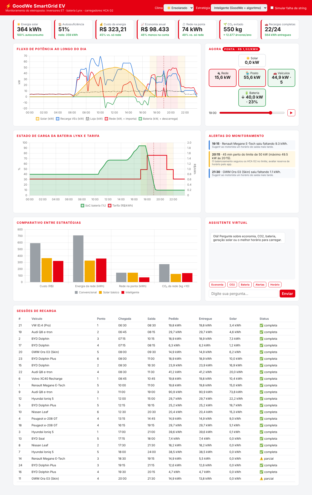
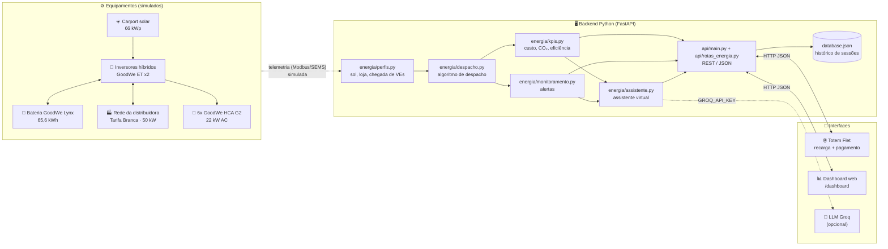
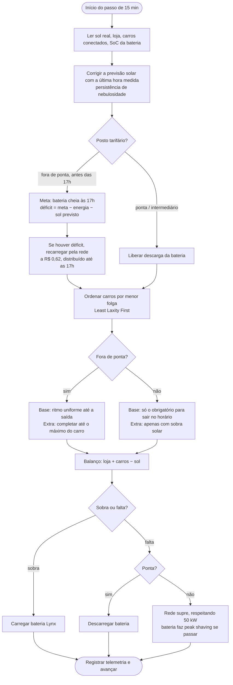
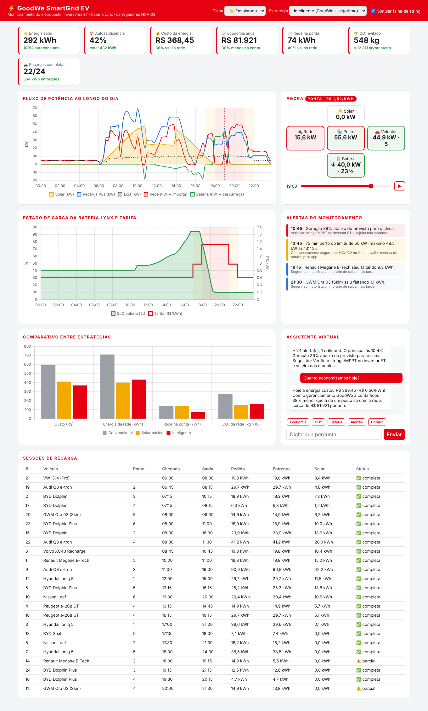
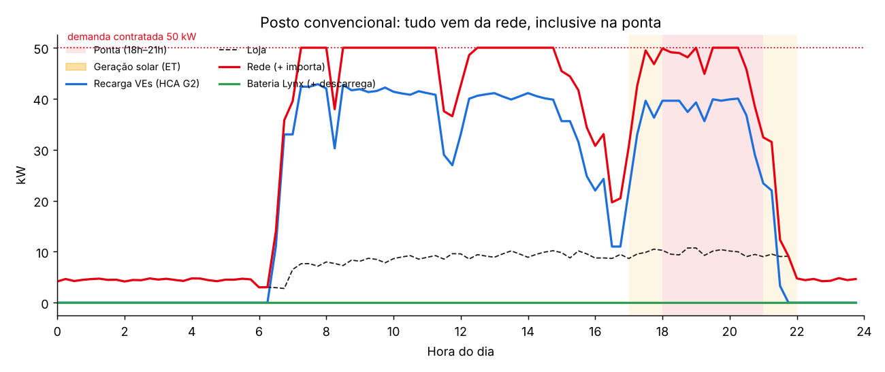
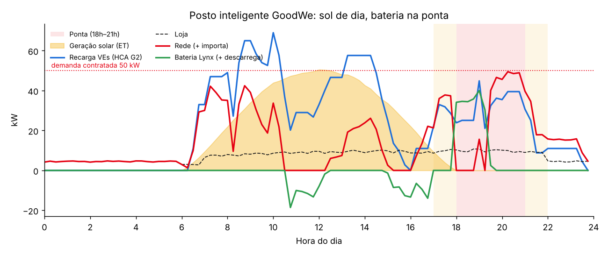
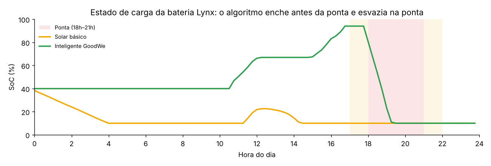
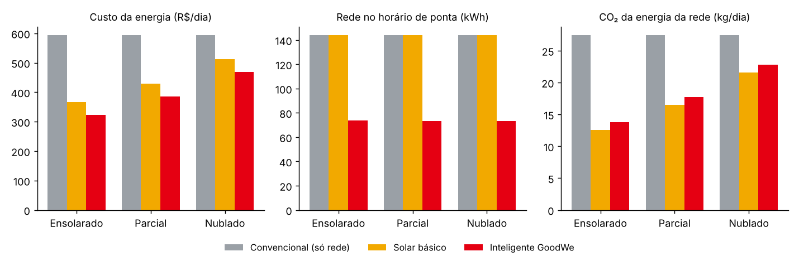

# ⚡ Totem EV Inteligente: GoodWe SmartGrid EV

**Sprint 4: Solução Final Integrada e Inovadora** · GoodWe Challenge · FIAP, Ciência da Computação, Turma 1CCPZ

Eletroposto que **gera** energia solar, **armazena** em bateria e **abastece** veículos elétricos, com um algoritmo que decide a cada 15 minutos de onde vem cada kW, um painel de monitoramento estilo SEMS Portal, alertas automáticos e um assistente virtual. Tudo construído sobre a linha de produtos GoodWe: inversores híbridos **série ET**, baterias **Lynx** e carregadores **HCA G2**.

> **Resultado principal (dia ensolarado, dados simulados):** o posto inteligente gasta **45% menos** com energia que um posto convencional, puxa **49% menos** energia da rede no horário de ponta e entrega carga completa para **22 de 24** motoristas, contra 16 de 24 no posto convencional.



---

## Sumário

1. [Equipe](#-equipe)
2. [O problema e a nossa resposta](#-o-problema-e-a-nossa-resposta)
3. [Arquitetura final e integração](#-arquitetura-final-e-integração)
4. [O algoritmo de despacho inteligente](#-o-algoritmo-de-despacho-inteligente)
5. [Monitoramento inteligente e assistente virtual](#-monitoramento-inteligente-e-assistente-virtual)
6. [Como executar](#-como-executar)
7. [Resultados quantitativos e qualitativos](#-resultados-quantitativos-e-qualitativos)
8. [Alinhamento ao desafio GoodWe e à disciplina](#-alinhamento-ao-desafio-goodwe-e-à-disciplina)
9. [Avaliação crítica: sustentabilidade e inovação](#-avaliação-crítica-sustentabilidade-e-inovação)
10. [Estrutura do repositório](#-estrutura-do-repositório)
11. [Referências e tecnologias](#-referências-e-tecnologias)

---

## 👥 Equipe

**Equipe 3 · GoodWe Challenge · Turma 1CCPZ**

| Nome | RM |
|---|---|
| Josué Franco Braga | 569174 |
| Andrei Henrique Santos | 569440 |
| Heitor Maxímus Mucha | 571407 |
| Enrico Marinho de Aquino | 569338 |
| Fernando Lobato Rodrigues | 569377 |
| Manoel da Silva Ferreira | 572045 |

📹 **Vídeo da solução:** _link do YouTube (não listado)_

---

## 🎯 O problema e a nossa resposta

Um eletroposto urbano tem três inimigos:

1. **O horário de ponta.** Na Tarifa Branca, a energia entre 18h e 21h custa mais que o dobro do fora de ponta (R$ 1,52 contra R$ 0,62 por kWh nos valores de referência que usamos), e é justamente quando os motoristas voltam do trabalho e querem carregar.
2. **O limite da rede.** O posto tem uma demanda contratada (50 kW, a mesma da Sprint 3). Seis carregadores de 22 kW somam 132 kW: não dá para ligar todos no máximo.
3. **A pegada de carbono.** Carro elétrico abastecido pela rede no pico é menos limpo e mais caro do que poderia ser.

Nas Sprints anteriores o totem já fazia **balanceamento de carga** (dividia os 50 kW entre os carros) e **cobrança**. Na Sprint 4 transformamos o totem em um **eletroposto completo**:

| Pilar do desafio | O que implementamos | Equipamento GoodWe |
|---|---|---|
| **Geração** | Carport solar de 66 kWp simulado em passos de 15 min, com três climas e previsão corrigida em tempo real | 2 inversores híbridos **série ET** (30 kW cada) |
| **Armazenamento** | Banco de 65,6 kWh que enche com sol (e com rede barata, se o sol não bastar) e descarrega na ponta | 4 torres de bateria **Lynx** (LFP, alta tensão) |
| **Uso / recarga** | 6 pontos de recarga com potência definida pelo algoritmo, priorizando quem vai sair primeiro | 6 carregadores **HCA G2** (22 kW AC) |
| **Monitoramento inteligente** | Dashboard web, alertas automáticos (falha de string, demanda, bateria, fila), totem mostrando a origem da energia | Conceito do **SEMS Portal** |
| **Interface e assistente** | Assistente virtual em português (regras offline + LLM opcional) | — |

---

## 🏗️ Arquitetura final e integração



### Como os sistemas conversam

1. **Simulação de campo** (`energia/perfis.py`): gera, para um dia inteiro em passos de 15 minutos, a potência dos painéis (curva solar × nebulosidade), o consumo da loja de conveniência e a chegada de 24 motoristas com horário de saída. A frota é a mesma de 14 modelos do totem da Sprint 3. É aqui que, numa instalação real, entrariam as leituras do inversor ET e do medidor bidirecional.
2. **Fila dos carregadores** (`perfis.alocar_carregadores`): distribui os carros pelos 6 pontos HCA G2. Quem chega com tudo ocupado espera e, se não houver vaga antes de ir embora, desiste.
3. **Despacho** (`energia/despacho.py`): a cada passo decide potência de cada carro, carga/descarga da bateria e troca com a rede (detalhes na próxima seção).
4. **Indicadores e alertas** (`energia/kpis.py`, `energia/monitoramento.py`): transformam a série em números de negócio e em avisos acionáveis.
5. **API** (`api/rotas_energia.py`): expõe tudo via REST. As rotas da Sprint 3 continuam iguais, e `/detectar-veiculo` agora também informa **de onde vem a energia naquele momento**.
6. **Totem Flet**: mostra no card "Rede / Balanceamento" a origem da energia (ex.: `Agora: 60% solar · 0% bateria · 40% rede (fora ponta)`).
7. **Dashboard** (`dashboard/index.html`): consome a API e mostra fluxo de potência, bateria, comparativo, alertas, sessões e o chat do assistente. O Chart.js vai junto no repositório, então funciona sem internet.

### Rotas da API

| Rota | Método | O que faz |
|---|---|---|
| `/detectar-veiculo` | GET | (Sprint 3) Sorteia o veículo e a potência; **novo:** inclui `energia_agora` |
| `/recalcular-potencia` | GET | (Sprint 3) Rebalanceamento quando um carro entra ou sai |
| `/gerar-recibo` · `/pagamento` · `/salvar-historico` | POST | (Sprint 3) Cobrança, pagamento e persistência |
| `/energia/configuracao` | GET | Parâmetros dos equipamentos GoodWe, tarifas e fator de emissão |
| `/energia/simulacao` | GET | Série de 96 passos + sessões + KPIs (`estrategia`, `clima`, `semente`, `falha_string`) |
| `/energia/comparativo` | GET | KPIs das 3 estratégias e ganhos do algoritmo |
| `/energia/alertas` | GET | Alertas do monitoramento |
| `/energia/agora` | GET | Leitura instantânea (`hora=HH:MM`, ou o relógio do servidor) |
| `/energia/assistente` | POST | Pergunta em linguagem natural → resposta do assistente |
| `/dashboard` | GET | Painel de monitoramento |

Documentação interativa (Swagger) em `http://127.0.0.1:8000/docs`.

---

## 🧠 O algoritmo de despacho inteligente

Comparamos três estratégias **no mesmo dia** (mesmo sol, mesma loja, mesmos carros, mesma fila):

| Estratégia | Descrição |
|---|---|
| `convencional` | Só rede. Divide a potência igualmente entre os carros (regra da Sprint 3). |
| `solar_basico` | Painéis + bateria GoodWe, mas "burros": guarda toda sobra e descarrega sempre que falta. |
| `inteligente` | Painéis + bateria + o algoritmo abaixo. |



As decisões principais:

- **Previsão solar com correção em tempo real** (`prever_solar`): parte da previsão do tempo (céu limpo × fator do clima) e multiplica pela razão entre o que os painéis entregaram na última hora e o que se esperava. Se uma nuvem ou uma falha derruba a geração, o algoritmo percebe e passa a comprar mais energia barata para a bateria.
- **Bateria cheia antes da ponta**: a meta é chegar às 17h com a Lynx em 95%, primeiro com sol e, se a previsão disser que o sol não basta, com a rede no fora de ponta (R$ 0,62). Essa energia substitui rede a R$ 1,52 no pico, o que compensa mesmo com 8% de perda no ciclo.
- **Least Laxity First** nos carregadores: o carro com menos folga (tempo até sair menos tempo mínimo de recarga) é atendido primeiro. Na ponta, cada carro recebe só o mínimo para sair com a carga pedida; o resto fica para depois das 21h ou para a sobra solar.
- **Respeito à demanda contratada**: a soma nunca passa de 50 kW importados da rede (verificado nos testes).

---

## 📡 Monitoramento inteligente e assistente virtual

### Alertas automáticos (`energia/monitoramento.py`)

| Alerta | Regra | Ação sugerida |
|---|---|---|
| 🔴 **Baixo desempenho solar** | Geração real < 65% da prevista para o clima durante 1 h | Verificar strings/MPPT no inversor ET e sujeira |
| 🟡 **Demanda no limite** | Importação ≥ 95% da demanda contratada | Avaliar reserva de horário pelo app |
| 🟡 **Bateria baixa na ponta** | SoC < 50% às 18h | Antecipar recarga no fora de ponta |
| 🔵 **Exportação alta** | > 20 kWh injetados na rede | Promoção de recarga no meio do dia |
| 🔵 **Recarga incompleta / desistência** | Carro saiu sem a carga pedida ou não achou vaga | Sugerir horário de saída mais tarde / novo ponto |

Ao marcar **"Simular falha de string"** no dashboard, metade do arranjo cai entre 11h e 14h. O monitoramento dispara um alerta crítico às 10h45 e o algoritmo, que percebe a queda pela correção da previsão, compensa comprando energia no fora de ponta. A bateria chega às 17h com 86%, praticamente o mesmo nível de um dia sem falha:



### Assistente virtual (`energia/assistente.py`)

- Entende perguntas em português por **intenção** (economia, CO₂, bateria, solar, melhor horário, alertas, recargas), sem acentos e sem formato fixo.
- Responde com os **dados reais da simulação** (ex.: _"Hoje a energia custou R$ 323,21 (R$ 0,44/kWh). Com o gerenciamento GoodWe a conta ficou 45% menor..."_).
- Se a variável `GROQ_API_KEY` existir, usa o mesmo provedor de LLM do chatbot **ChargeGrid AI** (disciplina de IA) para redigir a resposta, recebendo só os KPIs em JSON e instruído a não inventar números. Sem chave, ou se a chamada falhar, usa as regras: **o assistente nunca fica fora do ar**.
- Disponível no dashboard e via `POST /energia/assistente`, o que permite ligá-lo a assistentes de voz (Alexa/Google) por webhook.

---

## ▶️ Como executar

**Pré-requisito:** Python 3.10+

```bash
pip install -r requirements.txt
```

**1. API + dashboard** (na raiz do repositório):

```bash
uvicorn api.main:app --reload
```

- Dashboard: <http://127.0.0.1:8000/dashboard>
- Swagger: <http://127.0.0.1:8000/docs>

**2. Totem** (outro terminal, também na raiz):

```bash
python run.py
```

**3. Testes automatizados:**

```bash
python -m pytest
```

**4. Regerar gráficos e tabela de resultados:**

```bash
python scripts/gerar_graficos.py
```

**Opcionais** (variáveis de ambiente antes de subir a API):

- `GROQ_API_KEY=...`: o assistente passa a responder com LLM.
- `HORA_SIMULADA=12:30`: modo demonstração; o totem mostra a origem da energia desse horário em vez do relógio (útil para gravar o vídeo à noite).

---

## 📊 Resultados quantitativos e qualitativos

Todos os números vêm da simulação determinística (semente 42, 24 sessões, 6 carregadores, demanda contratada de 50 kW) e podem ser reproduzidos com `python scripts/gerar_graficos.py`. A tabela completa está em [`docs/RESULTADOS.md`](docs/RESULTADOS.md).

### Posto convencional × posto inteligente (dia ensolarado)




No convencional, a linha vermelha (rede) acompanha tudo, inclusive o pico das 18h às 21h. No inteligente, o sol cobre o meio do dia, a bateria (verde) carrega com a sobra das 10h às 17h e descarrega 40 kW no início da ponta.



### Indicadores (dia ensolarado)

| Indicador | Convencional | Solar básico | **Inteligente** |
|---|---:|---:|---:|
| Custo da energia (R$/dia) | 592,89 | 365,94 | **323,21** |
| Custo médio (R$/kWh) | 0,834 | 0,515 | **0,437** |
| Energia da rede no horário de ponta (kWh) | 144 | 144 | **74** |
| Autossuficiência | 0% | 54% | 51% |
| Recargas completas | 16/24 | 16/24 | **22/24** |
| Energia entregue aos VEs (kWh) | 535 | 535 | **564** |
| Margem da recarga (R$/dia) | 316,53 | 543,49 | **635,93** |
| Pico de demanda (kW) | 50,0 | 50,0 | 49,5 |
| Ciclos da bateria | — | 0,27 | 0,69 |

### Ganhos do algoritmo em cada clima



| Clima | Redução de custo | Redução de rede | Redução na ponta | Economia/ano* |
|---|---:|---:|---:|---:|
| Ensolarado | 45,5% | 49,4% | 48,7% | R$ 98.433 |
| Parcial | 34,9% | 35,2% | 49,0% | R$ 75.427 |
| Nublado | 20,9% | 16,6% | 49,1% | R$ 45.322 |

\* Extrapolação do dia simulado × 365. Ponderando 50% de dias ensolarados, 30% parciais e 20% nublados, a estimativa é de **≈ R$ 81 mil/ano**.

### Sustentabilidade

- **CO₂ evitado:** os 564 kWh entregues no dia rodam ≈ 3.300 km elétricos. Comparado a carros a gasolina, são **≈ 550 kg de CO₂ evitados por dia** (≈ 200 t/ano).
- **Menos carga na rede no pico:** −49% de energia puxada entre 18h e 21h, em qualquer clima. É o horário em que o sistema elétrico aciona térmicas.
- **Energia limpa na recarga:** 240 kWh por dia vão do sol direto para os carros.

### Resultados qualitativos

- O totem passou a contar ao motorista **de onde vem a energia** dele, o que torna o conceito de recarga solar visível.
- O operador tem em um só painel o que antes estava espalhado: fluxo, bateria, tarifa, alertas e sessões.
- A falha de string, que num posto real só apareceria na conta do mês, vira um **alerta em menos de 1 hora**.
- O assistente responde em linguagem natural para quem não lê gráfico.

---

## 🧩 Alinhamento ao desafio GoodWe e à disciplina

### Desafio GoodWe

| Requisito da Sprint 4 | Onde está resolvido |
|---|---|
| Geração, armazenamento e uso de energia renovável integrados | `energia/perfis.py` + `energia/despacho.py` simulam ET + Lynx + HCA G2 num mesmo balanço de potência, validado em teste (`test_balanco_de_potencia_fecha`) |
| Monitoramento inteligente | `energia/monitoramento.py`, `/energia/alertas`, dashboard e totem |
| Tecnologias compatíveis GoodWe | Parâmetros em `energia/config.py`, um bloco por equipamento; justificativa abaixo |
| Resultados reais ou simulados | Simulação determinística, tabela e gráficos gerados por script |
| Análise de impactos (técnica, eficiência, carbono, social) | Seções de resultados e avaliação crítica |
| Algoritmos inteligentes | Previsão solar com correção, Least Laxity First, arbitragem tarifária, peak shaving |
| Automações avançadas | Recarga da bateria pela rede decidida sozinha; alertas automáticos |
| Interface amigável e visualização de dados | Dashboard web e totem Flet |
| Integração com assistentes virtuais | Assistente com regras + LLM opcional, exposto por API |

**Por que cada equipamento GoodWe:**

- **Inversor híbrido série ET:** um único equipamento faz o MPPT dos painéis, carrega e descarrega a bateria e conversa com a rede. É o que permite o algoritmo decidir "sol → bateria" ou "rede → bateria" sem hardware extra. Usamos dois em paralelo (60 kW) para o carport de 66 kWp.
- **Bateria Lynx (alta tensão, LFP):** química LFP aguenta ciclos diários, e o sistema é modular em torres, então o banco pode crescer com o posto. Limitamos o SoC entre 10% e 95% no código para preservar vida útil.
- **Carregador HCA G2:** carregador AC de até 22 kW com potência ajustável. É exatamente o "atuador" que o algoritmo precisa: ele não liga/desliga, ele **modula** a potência de cada carro.
- **SEMS Portal (conceito):** nosso dashboard e nossos alertas seguem a lógica do portal de monitoramento GoodWe. Em produção, o backend leria os dados reais pela API do SEMS ou por Modbus-TCP no lugar de `perfis.py`.

### Conteúdos da disciplina aplicados

| Conteúdo | Onde aparece |
|---|---|
| Funções, parâmetros com valor padrão, retorno de dicionários | Todo o pacote `energia/` |
| Estruturas de dados (listas, dicionários, tuplas) | Séries de 96 passos, sessões, tabelas de tarifa |
| Laços e condicionais | Loop de simulação e regras do despacho |
| Orientação a objetos | Classe `Bateria`, com propriedades e métodos que respeitam limites físicos |
| Modularização e pacotes | `energia/` separado de `api/`, `totem/`, `dashboard/` |
| APIs REST com FastAPI, rotas GET/POST, `APIRouter` | `api/main.py`, `api/rotas_energia.py` |
| Validação com Pydantic e `Literal` | `PerguntaRequest`, parâmetros `estrategia` e `clima` |
| Requisições HTTP com `requests` | Totem → API e assistente → LLM |
| Programação assíncrona (`asyncio`) | Loop de recarga do totem |
| Tratamento de exceções | Fallback do assistente, leitura do `database.json` |
| Arquivos e JSON | Persistência das sessões, respostas da API |
| Cache (`functools.lru_cache`) | Simulações repetidas instantâneas no dashboard |
| Testes automatizados (`pytest`, `TestClient`) | `tests/test_energia.py`, 25 testes |
| Visualização de dados (`matplotlib`) | `scripts/gerar_graficos.py` |
| Conceitos de energia renovável | Peak shaving, geração distribuída, Tarifa Branca, autoconsumo, SCEE (Lei 14.300) |

---

## 🌱 Avaliação crítica: sustentabilidade e inovação

**O que funciona bem**

- O ganho na **ponta é robusto**: cai ~49% em qualquer clima, porque depende da bateria e da modulação dos carregadores, não do sol do dia.
- O algoritmo **atende mais motoristas** (22 contra 16 recargas completas) com **menos custo**. Isso vem da priorização por folga: o carro que vai sair logo recebe potência primeiro.
- A margem da recarga dobra (R$ 317 → R$ 636 por dia), o que é o argumento para o dono do posto investir na tecnologia.

**Limitações que assumimos**

- **Os dados são simulados.** Usamos tarifas, fatores de emissão e perfis de chegada de referência, não medições de um posto real. Os parâmetros ficam em `energia/config.py` justamente para serem trocados por dados reais.
- **CO₂ da rede no inteligente fica ~9% acima do solar básico** (13,8 contra 12,6 kg/dia no dia ensolarado). Ele entrega mais energia aos carros (564 contra 535 kWh) e às vezes enche a bateria com rede barata. Na matriz brasileira, que é muito renovável, o efeito é pequeno, mas é um trade-off real entre custo e carbono. Uma evolução seria um modo "carbono mínimo" que só carrega a bateria com sol.
- **A economia anual é extrapolada** de um dia típico. Não modelamos sazonalidade, degradação da bateria nem o investimento (CAPEX). Um próximo passo é calcular o payback.
- **O exportado foi zero** neste dimensionamento, pois tudo que o sol gera é consumido. Num posto com menos carros, o alerta de exportação sugere promoções no meio do dia.

**Onde está a inovação**

1. Despacho que combina **previsão solar corrigida, arbitragem tarifária e prioridade por prazo** num algoritmo explicável e leve, que roda localmente no posto sem depender de nuvem.
2. **Monitoramento que compara o real com o esperado para o clima**: separa "está nublado" de "tem algo quebrado".
3. **Transparência para o motorista:** o totem mostra a origem da energia de cada recarga.
4. **Assistente híbrido** (regras + LLM): funciona offline e fica mais natural quando há internet.

---

## 📁 Estrutura do repositório

```text
.
├── api/
│   ├── main.py              # API FastAPI (rotas da Sprint 3 + inclusão das rotas de energia)
│   ├── rotas_energia.py     # Rotas da Sprint 4: simulação, comparativo, alertas, assistente, dashboard
│   └── pagamento.py         # Simulação de gateway de pagamento
├── energia/                 # Núcleo da solução integrada
│   ├── config.py            # Equipamentos GoodWe, tarifas, fatores de emissão
│   ├── perfis.py            # Sol, loja, chegada de VEs, fila dos carregadores
│   ├── despacho.py          # Bateria, previsão solar e algoritmo de despacho
│   ├── kpis.py              # Indicadores de custo, eficiência e CO₂
│   ├── monitoramento.py     # Alertas automáticos
│   └── assistente.py        # Assistente virtual
├── dashboard/
│   ├── index.html           # Painel de monitoramento
│   └── vendor/              # Chart.js local (funciona offline)
├── totem/main.py            # Totem Flet (agora mostra a origem da energia)
├── scripts/gerar_graficos.py
├── tests/test_energia.py
├── docs/
│   ├── img/                 # Gráficos e capturas usados neste README
│   ├── RESULTADOS.md        # Tabela completa gerada pelo script
│   ├── ROTEIRO_VIDEO.md     # Roteiro do vídeo de 5 minutos
│   ├── ARQUITETURA.md
│   ├── GUIA_TECNICO.md
│   └── Entrega_*.pdf        # Entregas das sprints anteriores
├── database.json            # Histórico de sessões do totem
├── run.py                   # Inicia o totem
└── requirements.txt
```

---

## 📚 Referências e tecnologias

**Linguagens e frameworks**

- Python 3.10+
- [FastAPI](https://fastapi.tiangolo.com/) e [Pydantic](https://docs.pydantic.dev/): API REST e validação
- [Uvicorn](https://www.uvicorn.org/): servidor ASGI
- [Flet](https://flet.dev/): interface do totem
- [Requests](https://requests.readthedocs.io/): cliente HTTP
- [Chart.js 4.4.1](https://www.chartjs.org/) (MIT): gráficos do dashboard
- [Matplotlib](https://matplotlib.org/): gráficos do relatório
- [pytest](https://docs.pytest.org/): testes
- [Groq API](https://console.groq.com/docs) (opcional): LLM do assistente, o mesmo do ChargeGrid AI

**Equipamentos GoodWe** (parâmetros de referência em `energia/config.py`)

- Inversor híbrido trifásico série ET: <https://www.goodwe.com>
- Baterias de alta tensão Lynx
- Carregador de VE HCA G2 (AC, até 22 kW)
- SEMS Portal: plataforma de monitoramento GoodWe

**Sensores e medições** (simulados nesta versão; em campo viriam destes pontos)

| Grandeza | Sensor/fonte real |
|---|---|
| Potência e energia fotovoltaica, MPPT | Telemetria do inversor ET |
| SoC, potência e temperatura da bateria | BMS da bateria Lynx (via inversor) |
| Importação/exportação no ponto de conexão | Medidor inteligente bidirecional trifásico |
| Energia e potência por sessão | Medição interna do carregador HCA G2 |
| Irradiância e previsão do tempo | Previsão meteorológica + correção pela própria geração |

**Regulação e dados de referência**

- ANEEL: estrutura da Tarifa Branca (postos fora de ponta, intermediário e ponta)
- Lei 14.300/2022: Sistema de Compensação de Energia Elétrica (geração distribuída)
- MCTI: fatores de emissão de CO₂ do Sistema Interligado Nacional
- Algoritmo Least Laxity First: escalonamento por menor folga, clássico de sistemas de tempo real, aplicado a recarga de VEs
